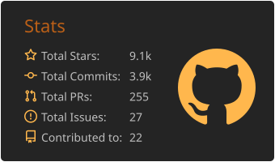

 <!-- See https://github.com/simple-icons/simple-icons/issues/11372 -->

## OSS Development

### CLIs

- [ynqa/jnv](https://github.com/ynqa/jnv): Interactive JSON filter using `jq`
 
- [ynqa/sig](https://github.com/ynqa/sig): Interactive grep (for streaming)
 
- [ynqa/logu](https://github.com/ynqa/logu): Extract patterns from unstructured log messages
 
- [ynqa/empiriqa](https://github.com/ynqa/empiriqa): Laboratory for pipeline construction with feedback
 
- [ynqa/kuqu](https://github.com/ynqa/kuqu): SQL for Kubernetes resources
 
- [ynqa/vy](https://github.com/ynqa/vy): Explore and query JSON and YAML, right in your terminal
 
- [ynqa/nosy](https://github.com/ynqa/nosy): Summarize content from URLs and local files using LLMs
 
- [ynqa/hstr-rs](https://github.com/ynqa/hstr-rs): A minimal hstr clone built with promkit
 
- [ynqa/grfnctl](https://github.com/ynqa/grfnctl): CLI for the Grafana API
 
- [ynqa/convey](https://github.com/ynqa/convey): Compose structured prompts from YAML in an interactive TUI and send them to terminal panes
 
- [ynqa/envoy-lb-simulator](https://github.com/ynqa/envoy-lb-simulator): Simulate load balancing for Envoy proxy
 
- [ynqa/maqi](https://github.com/ynqa/maqi): A shell reimagined for the AI era
 

### Libraries

- [ynqa/wego](https://github.com/ynqa/wego): Word Embeddings in Go!
 
- [ynqa/promkit](https://github.com/ynqa/promkit): Make interactive prompt in Rust
 
- [ynqa/kubernetes-rust](https://github.com/ynqa/kubernetes-rust): Rust client for Kubernetes
 
- [ynqa/pandavro](https://github.com/ynqa/pandavro): Apache Avro <-> pandas DataFrame
 
- [ynqa/j9](https://github.com/ynqa/j9): Rust bindings for \*jq\*
 
- [ynqa/fuzzy-search](https://github.com/ynqa/fuzzy-search): Collections for efficient fuzzy string search
 
- [ynqa/jsoniterx](https://github.com/ynqa/jsoniterx): Extensions for json-iterator/go
 
- [ynqa/lanterm](https://github.com/ynqa/lanterm): Toolkit for building PTY-backed terminal experiences in the browser
  
- [ynqa/termcfg](https://github.com/ynqa/termcfg): Configure terminal shortcuts and styles with compact strings
 
- [ynqa/termharness](https://github.com/ynqa/termharness): Test terminal applications with PTY-driven scenarios and ANSI screen assertions
 
- [ynqa/kubex](https://github.com/ynqa/kubex): Utilities for Kubernetes in Rust
 

### Extensions

- [ynqa/claude-convey](https://github.com/ynqa/claude-convey): Fill Claude Code prompts by picking values in a form
 
- [ynqa/helmingway](https://github.com/ynqa/helmingway): Preview, filter, and compare Helm-rendered Kubernetes manifests in VS Code
 

### Servers & Exporters

- [ynqa/faiss-server](https://github.com/ynqa/faiss-server): gRPC services for similarity search using Faiss
 
- [ynqa/tf_serving_exporter](https://github.com/ynqa/tf_serving_exporter): Prometheus exporter for TensorFlow Serving metrics
 
